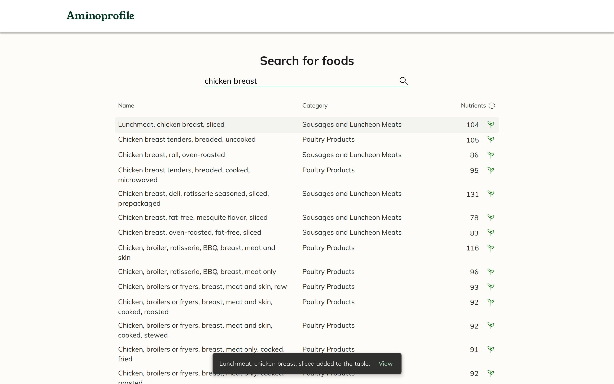
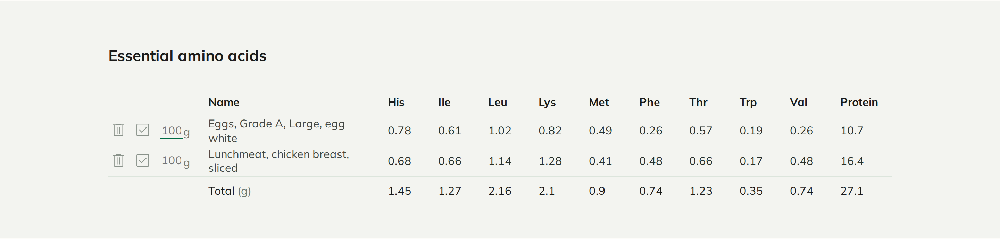

# Aminoprofile

Search for foods and compare their essential amino acids. Aminoprofile looks foods up in
[USDA FoodData Central](https://fdc.nal.usda.gov/), shows which results have amino acid data,
and adds up the nine essential amino acids and protein of the foods you pick.





## What it does

- **Search.** Type a food and press Enter. Results come from the *Foundation Foods* and
  *SR Legacy* data sets of FoodData Central, the two that have amino acid data. Every word you
  type must be in the food's name (if that finds nothing, any word will do), and the 25 best
  matches are shown. Foods with amino acid data are listed first and marked with a green sprout;
  the number next to it is how many nutrients USDA has for that food.
- **Compare.** Click a food (or press Enter on it) to add it to the *Essential amino acids*
  table: histidine, isoleucine, leucine, lysine, methionine, phenylalanine, threonine,
  tryptophan, valine and protein, in grams. A missing value shows as a dash (—), which is not
  the same as 0.
- **Combine.** Change the amount per food (100 g by default) and tick the foods to include. Each
  row shows the grams for its amount, and the *Total* row adds up the ticked rows, so you can see
  what a combination of foods gives you. When a ticked food has no value for an amino acid, its
  total is marked "≥": the real amount is at least that.

Aminoprofile is a desktop site. Below 1240 pixels wide it shows a "will be available on mobile
soon" screen, as it did in 2023.

## Origin

Aminoprofile was designed in Figma first and then built by hand in October 2023, without any AI
assistance: Nuxt 3, Vue, Pinia, Pug templates and SCSS, with its own colour palette and
typefaces (Mulish and Young Serif). The design closely follows Google's
[Material Design 3](https://m3.material.io/), which inspired it: the colour roles and tonal
palettes in `assets/style/_variables.scss`, the surfaces, and the Material Symbols icons. It
ran at aminoprofile.com until it was taken offline.

## 2026 maintenance

In November 2026 the site was prepared to go back online. This maintenance was done with
[Claude Code](https://claude.com/claude-code). The look and the texts were deliberately left as
they were in 2023, apart from four small additions (the last item below). What changed:

- **API key on the server.** The browser used to call FoodData Central directly, so the API key
  was shipped in the JavaScript bundle. Searches now go through a server route
  (`server/api/foods/search.get.ts`) that holds the key. That route accepts only a search term
  of 2 to 100 characters, has a 15 second timeout and passes on no upstream error details.
- **The right numbers.** Three columns of the table showed the wrong amino acid: *His* showed
  valine, and *Phe* and *Val* both showed histidine. The values are now picked by USDA's
  nutrient id in one shared list (`shared/nutrients.ts`). Rows now show the grams for the amount
  typed (the total already did), 0 g counts as 0 g instead of 100 g, removing a food no longer
  unticks another one, and a food cannot be added twice.
- **Search.** SR Legacy was added next to Foundation Foods: Foundation has amino acids for 118 of
  its 424 foods, SR Legacy for about 5,100 of 7,793 (a search for lentils, tofu or salmon found
  none before). The server picks the ten values the page uses out of USDA's answer, so the page
  receives about 7 kB instead of the up to 0.9 MB USDA sends for 25 foods. A newer search
  cancels an older one, pressing Enter twice asks only once, and there are messages for "too
  short", "nothing found", "too many searches" (with the wait the server gives in
  `Retry-After`), "no internet connection" and "database unavailable", the last two with a
  *Try again* button. What is on screen stays until the next answer arrives; the spinner only
  appears when an answer takes longer than 150 ms, so cached answers do not flicker.
- **Caching.** Answers are kept in the server's memory (an hour, at most 200 searches), in
  Cloudflare's cache (`caches.default`, a day) and in the browser (`Cache-Control`, an hour).
  Identical searches that arrive at the same time ask USDA once (`server/utils/searchCache.ts`).
- **Fonts.** Mulish and Young Serif are served as WOFF2 files with only the Latin characters
  (57 kB instead of 316 kB of TTF), are preloaded, and use `font-display: swap`. Until they
  arrive, text shows in Arial and the name in Times New Roman, resized to take the same room
  (`size-adjust` and the metric overrides in `assets/style/app.scss`), so the page appears at
  once with the name in place and hardly moves when the fonts swap in. Before, the name stayed
  invisible until its font had loaded (3.2 s on a slow connection). The `*-Latin.woff2` files
  were made from the TTF files next to them with
  [subset-font](https://github.com/papandreou/subset-font) 2.9 (HarfBuzz), `targetFormat:
  'woff2'`, for the characters of Google Fonts' "latin" range (U+0020-007E, U+00A0-00FF,
  U+0131, U+0152-0153, U+02BB-02BC, U+02C6, U+02DA, U+02DC, U+0304, U+0308, U+0329,
  U+2000-206F, U+20AC, U+2122, U+2191, U+2193, U+2212, U+2215, U+FEFF, U+FFFD). All OpenType
  features and the whole weight axis of Mulish are kept: text renders exactly as with the TTF
  files. Without JavaScript the page says that search needs it.
- **No stylesheet to wait for.** The global stylesheet (2.5 kB) is inlined in the HTML, as the
  component styles already were (`features.inlineStyles` in `nuxt.config.ts`), so the first
  paint waits for no CSS request. Everything under `/_nuxt/` (scripts, styles, fonts) has a
  content hash in its name and is cached for a year (`immutable`, in the generated `_headers`).
- **Search engines, AI assistants and shared links.** `public/robots.txt` lets every crawler
  read the pages but not `/api/`, and names the AI crawlers (GPTBot, OAI-SearchBot,
  ChatGPT-User, ClaudeBot, Claude-SearchBot, Claude-User, PerplexityBot, Google-Extended,
  Applebot-Extended, CCBot) with the same rules; `public/sitemap.xml` lists the two pages and
  `public/llms.txt` ([llmstxt.org](https://llmstxt.org/)) says what the site does, where the
  data comes from and whom to contact. Each page has its own title, description and canonical
  link to `https://aminoprofile.com` (`shared/site.ts`), Open Graph and Twitter card tags with a
  1200x630 picture in the site's style (`public/og-image.png`, made from
  `docs/og-image.html`), and the home page describes itself as a `WebApplication` in JSON-LD.
  There is also a `theme-color` (white, like the header) and a web manifest with the app icons.
- **Accessibility.** The search box has a label; the search, info, remove and tick icons are
  real buttons that work with the keyboard and have a visible focus ring; results can be added
  with Enter; a status line tells screen readers what happened; the page has `lang="en"`,
  landmarks and a correct heading order; and the few grey texts that measured below WCAG AA
  contrast were darkened by an invisible amount. Greyed-out results and unticked rows stay pale
  on purpose: they are inactive.
- **Error page.** Unknown addresses get a "Page not found" page in the site's style, with a 404.
- **Analytics without cookies.** Google Analytics was replaced by Cloudflare Web Analytics,
  which uses no cookies and collects no personal data. It is only loaded when a token is
  configured. Without cookies, the site needs no cookie banner.
- **Security headers.** `X-Content-Type-Options`, `Referrer-Policy`, `X-Frame-Options`,
  `Permissions-Policy`, `Strict-Transport-Security` and a light `Content-Security-Policy`, set in
  `routeRules` in `nuxt.config.ts`.
- **Privacy page** at `/privacy`, linked from the footer (and from the mobile screen).
- **Two names that wrap.** In the search results the nutrient count now sits on the first line
  of a two-line name, like the category; in the amino acids table a two-line name gets the same
  room above and below as the amounts, so it no longer touches the next row.
- **Dependencies.** Upgraded from Nuxt 3.7 to Nuxt 4 and Pinia 4. Unused packages were removed,
  and the build output that had been committed by accident was taken out of the repository.
- **Four small additions**, in the Material 3 style of the rest:
  - *Favicon.* The sprout from the search results, filled, white on a rounded tile in the
    primary green, as SVG, ICO (16/32/48), a 180 px iPhone icon and 192/512 px manifest icons
    (one maskable). `scripts/make-favicons.py` makes them from `assets/icons/minerals.svg`.
  - *Full names.* Hovering *His*, *Ile* and the other abbreviations shows the full amino acid name
    in a Material plain tooltip.
  - *Empty values.* A value FoodData Central does not have is a dash instead of "N/a", as in
    Material data tables; its tooltip says which amino acid is missing, and an empty or
    incomplete total says why.
  - *Feedback when adding.* Clicking a result shows a Material snackbar at the bottom ("… added
    to the table.") with a *View* button that scrolls to the table, which is usually below the
    fold. It hides itself after 4 seconds.

## Stack

- [Nuxt 4](https://nuxt.com/) (Vue 3, Nitro), keeping the original root folder layout
- [Pinia](https://pinia.vuejs.org/) for the search results and the selected foods
- Pug templates and SCSS
- [nuxt-icons](https://github.com/gitFoxCode/nuxt-icons) for the SVG icons
- [USDA FoodData Central API](https://fdc.nal.usda.gov/api-guide) for the food data
- Hosted on [Cloudflare Workers](https://developers.cloudflare.com/workers/) (Nitro preset
  `cloudflare-module`)

## Running it locally

You need Node.js 22.22.3+, 24.15+ or 26 (the versions Nuxt 4.6 supports).

```bash
npm install
cp .env.example .env   # optional, see below
npm run dev            # http://127.0.0.1:3000
```

### Environment variables

| Variable | Required | What it does |
| --- | --- | --- |
| `NUXT_FOODCENTRAL_API_KEY` | No | Your FoodData Central API key ([free sign-up](https://fdc.nal.usda.gov/api-key-signup)). Only the server uses it; it never reaches the browser. **When it is not set, the server falls back to USDA's shared `DEMO_KEY`**, which is heavily rate limited and only meant for trying things out. Set a real key for anything public. |
| `NUXT_PUBLIC_CF_BEACON_TOKEN` | No | Cloudflare Web Analytics token. When it is not set, no analytics script is loaded at all. |
| `NUXT_FOODCENTRAL_API_URL` | No | Only for testing against a local stand-in of the API. Default `https://api.nal.usda.gov/fdc/v1`. |

To run a production build as a plain Node server instead of a Worker:

```bash
NITRO_PRESET=node-server npm run build
node .output/server/index.mjs
```

## Deploying to Cloudflare Workers

The default build targets Cloudflare Workers:

1. `npm run build` writes the Worker to `.output/`, including `.output/server/wrangler.json`
   (Worker name `aminoprofile`, compatibility date and static assets) and
   `.output/public/_headers` (the security headers for static files).
2. `npx wrangler deploy` deploys the build (it finds the generated config through
   `.wrangler/deploy/config.json`). With Cloudflare's Git integration (Workers Builds), use
   `npm run build` as the build command and `npx wrangler deploy` as the deploy command.
3. Set the variables as Worker secrets, so later deploys keep them:
   `npx wrangler secret put NUXT_FOODCENTRAL_API_KEY --name aminoprofile` and, if you use
   analytics, `npx wrangler secret put NUXT_PUBLIC_CF_BEACON_TOKEN --name aminoprofile`.
   The server reads them on every request, so no rebuild is needed.
4. Attach the domain under the Worker's *Settings → Domains & Routes*. The domain has to use
   Cloudflare DNS.
5. Add a WAF rate limiting rule for `/api/foods/search`, for example 10 requests per 10 seconds
   per IP address. Every search that is not cached uses the FoodData Central quota of the API
   key (1,000 requests per hour by default), so this keeps one visitor from using it all up.

## Data

Food data: U.S. Department of Agriculture, Agricultural Research Service. FoodData Central,
2019. [fdc.nal.usda.gov](https://fdc.nal.usda.gov/). FoodData Central data is in the public
domain.

## License

The code is available under the [MIT License](LICENSE). The food data comes from FoodData
Central (see above) and is not covered by this license. The typefaces in `assets/fonts`, Mulish
and Young Serif, are under the SIL Open Font License 1.1; each folder holds its `OFL.txt`.
